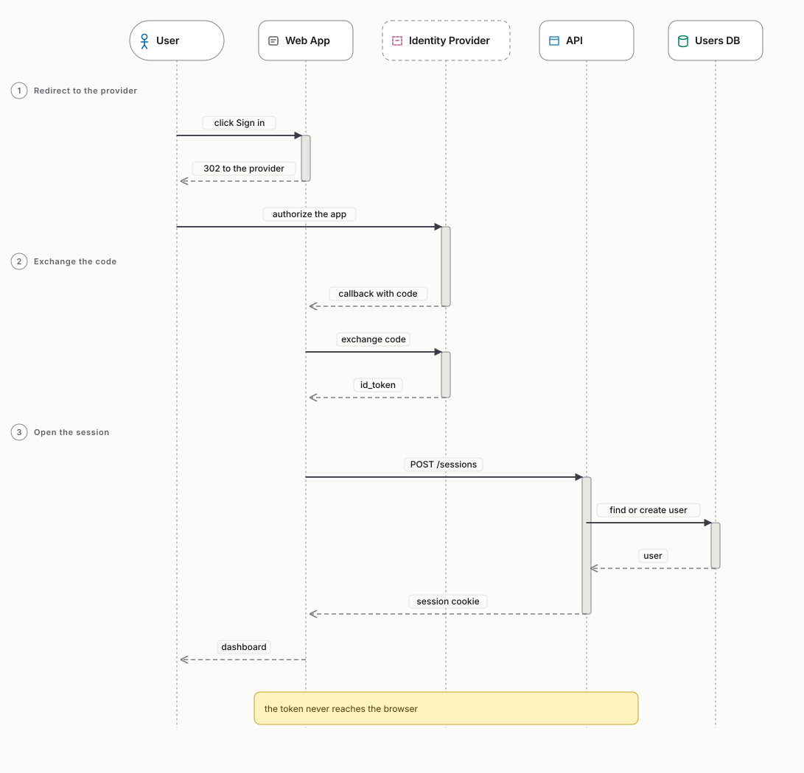
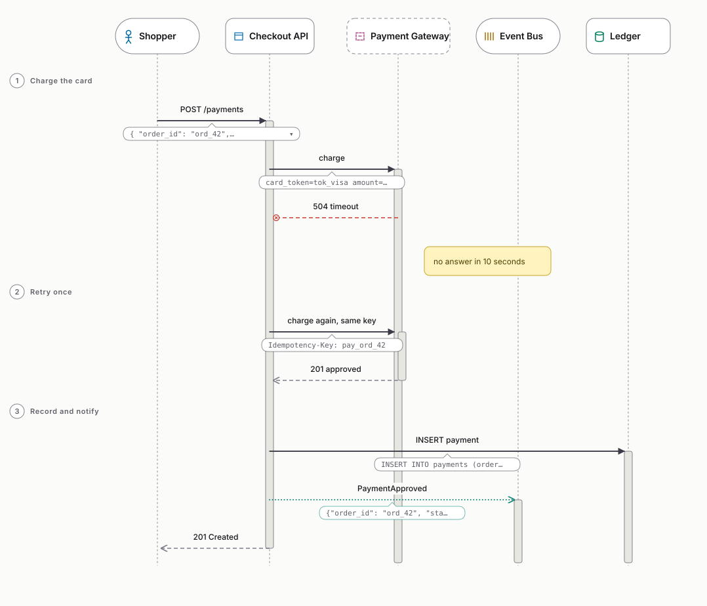
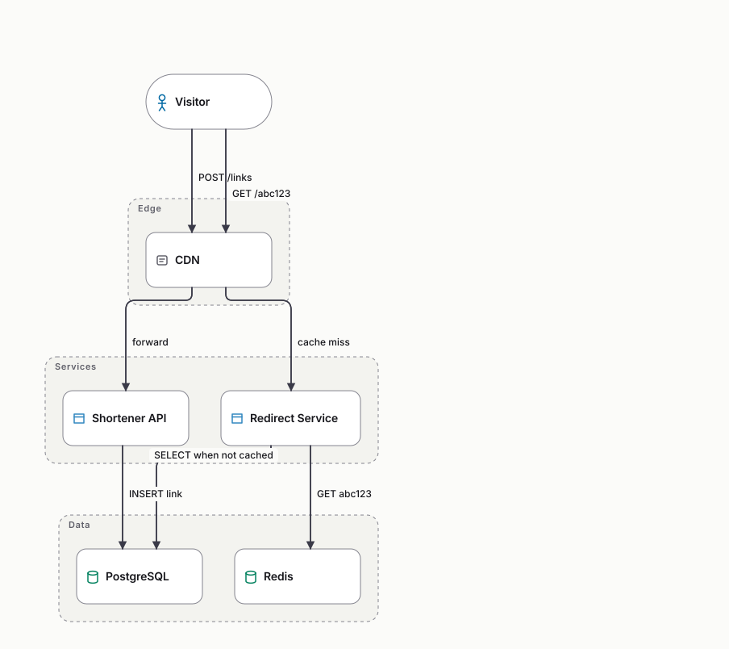
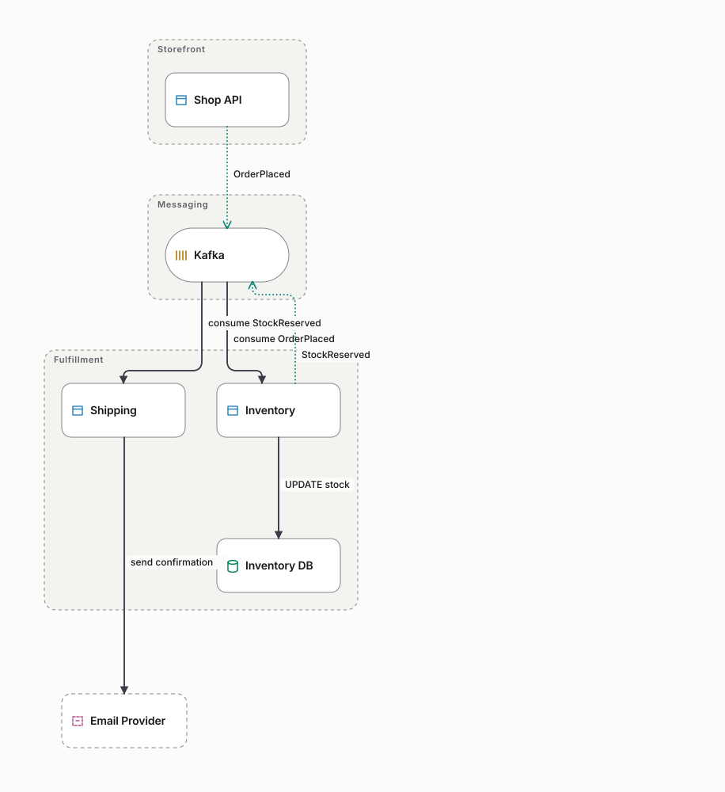

# Examples

**English** · [Português (Brasil)](README.pt-BR.md)

Ready-to-use diagrams: open the Brainagram editor, choose **Open → Import** (or
paste the text), and press play. Each `.brain` file has an `.svg` next to it
with its final state, generated by `mix brainagram.render`.

## Sequence diagrams

| File | What it shows |
|---|---|
| [`sequence/oauth-sign-in.brain`](sequence/oauth-sign-in.brain) | **Without payloads.** Sign in with an identity provider, in three steps: calls, returns and a note. |
| [`sequence/card-payment-with-payloads.brain`](sequence/card-payment-with-payloads.brain) | **With payloads.** A card payment where the gateway times out (`-x`), a retry, then the ledger and an event. JSON, header and SQL payloads, in one-line and multi-line form. |

<p>
  
  
</p>

## Architecture diagrams

| File | What it shows |
|---|---|
| [`architecture/url-shortener.brain`](architecture/url-shortener.brain) | **Without payloads.** Groups (edge, services, data) and two flows: creating and following a short link. |
| [`architecture/order-approval.brain`](architecture/order-approval.brain) | **Decision flow.** `decision` diamonds with the question inside, `yes` / `no` arrows leaving by different tips, laid out left to right (`direction horizontal`). |
| [`architecture/event-driven-orders.brain`](architecture/event-driven-orders.brain) | **With payloads.** Asynchronous events (`->>`) through Kafka, with the event body, an SQL update and an email request. |

<p>
  
  
</p>

## Coming from Mermaid or PlantUML

Brainagram **imports** Mermaid and PlantUML, so existing diagrams don't need to
be rewritten. Paste the file in an import dialog and you get the `.brain`
text, ready to play. Anything that doesn't convert becomes a comment at the top
of the code; the import never fails because of one unknown line.

| Source | Becomes | Converted result |
|---|---|---|
| [`import/mermaid/password-reset.mmd`](import/mermaid/password-reset.mmd) (Mermaid `sequenceDiagram`) | sequence | [`password-reset.brain`](import/mermaid/password-reset.brain) |
| [`import/mermaid/order-pipeline.mmd`](import/mermaid/order-pipeline.mmd) (Mermaid `flowchart`) | architecture | [`order-pipeline.brain`](import/mermaid/order-pipeline.brain) |
| [`import/plantuml/file-upload.puml`](import/plantuml/file-upload.puml) (PlantUML sequence) | sequence | [`file-upload.brain`](import/plantuml/file-upload.brain) |
| [`import/plantuml/analytics-components.puml`](import/plantuml/analytics-components.puml) (PlantUML component) | architecture | [`analytics-components.brain`](import/plantuml/analytics-components.brain) |

What converts:

- **Mermaid `sequenceDiagram`:** participants and actors (with `as`), `box` as
  a group, sync, return, async and failure arrows, notes, `title`, and
  `alt`/`else`/`opt`/`loop`/`critical`/`break` as steps. `par`, `rect` and
  bidirectional arrows are reported in the comment; their messages are kept.
- **Mermaid `flowchart` / `graph`:** becomes architecture. Every node shape
  converts; a cylinder (`[( )]`) is a database, and the other kinds come from
  the class name (`classDef queue …`, `class X ext`, `X:::store`) or from the
  label ("queue", "Redis", "clients"…). `subgraph` becomes a group, `-.->` an
  async arrow, `--x` a failure, and chains (`A --> B --> C`) and fan-outs
  (`A & B --> C`) become one arrow each. Links without a head, two-way links
  and links to a subgraph are reported in the comment.
- **PlantUML sequence:** `participant`, `actor`, `database`, `queue` and the
  other participant kinds, `box` as a group, `->`, `-->`, `->>`, `->x`,
  reversed arrows, notes, `title`, `== section ==` and
  `alt`/`else`/`opt`/`loop`/`group` as steps.
- **PlantUML component (or deployment):** `[Component]`, `component`,
  `database`, `queue`, `actor`, `cloud`, `node`… and containers such as
  `package`, `node` or `cloud` become groups; `..>` becomes an async arrow.

## Render or check them from the command line

```bash
mix brainagram.render examples/sequence/oauth-sign-in.brain         # → .svg next to it
mix brainagram.fmt --check-formatted examples/**/*.brain             # canonical formatting, for CI
```

The diagrams behind the README GIFs live in [`../docs/examples/`](../docs/examples).
